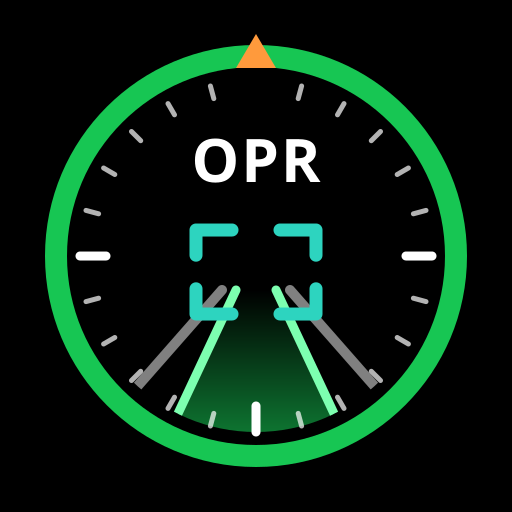

<p align="center">
  
</p>

# OPRivView

**English** | [繁體中文](README_zh-TW.md) (describes the original opview)

OPRivView shows a comma device's driving screen live on an Android phone, tablet or car head unit,
including the EV Play box on a Rivian's center screen: the road camera with the openpilot /
sunnypilot overlay drawn on top. It is a fork of [eFiniLan/opview](https://github.com/eFiniLan/opview),
a clone of [openpilot](https://github.com/commaai/openpilot)'s onroad UI built in Flutter, with
[Gerrylum](https://github.com/gerrylum/opview)'s layouts and app features and Geomglot's sunnypilot
and Rivian additions. No 3D library is needed; all projection is 3x3 matrix math in Dart.

**Using the app:** see the [user guide](docs/USER_GUIDE.md).

<p align="center">
  <a href="https://youtube.com/shorts/r0O_RzXd_0k">
    
  </a>
</p>

## Features

- **Three layouts**, switched by swiping sideways:
  - **Classic:** close to the comma's own screen, with sunnypilot's speed limit sign, road name,
    steering wheel, turn signal arrows and MADS border colors.
  - **Enhanced:** modeled on the comma four's screen: full-screen camera, lead car box and readout,
    blind spot glow, driver monitoring icon and model confidence ball.
  - **Detailed:** Enhanced plus foldable side panels of live data (steering, driver, longitudinal,
    lead and second lead) and the comma's health.
- **Bottom bar, per layout:** the torque bar, the lane centering indicator, Auto, or nothing. Tap the
  bottom center of the screen to step through them.
- **Lane centering indicator** for Geomglot's sunnypilot build: how hard and which way it is pushing,
  the distance off center (metric or imperial, following the comma), and One-Line Mode.
- **Settings** (press and hold): layout, bottom bar, speed limit, brightness, comma address, road
  name, picture-in-picture, updates.
- **Picture-in-picture:** a small floating view when you leave the app, where Android supports it.
- **In-app updates** from this repository's releases; every release is signed with one key, so
  updates install over the top.
- **Self-repairing connection:** automatic discovery, a remembered address, and a watchdog that
  rebuilds a stalled stream.

## Requirements

- **Android 7.0 or later.**
- **A comma device whose `webrtcd` service runs while driving** and is reachable on port 5001, on the
  same network as the Android device.
  - **Geomglot's sunnypilot build** (Geomglot/openpilot, branch `dys-a`) does this, and adds the
    slimmed data stream the app is tuned for, the lane centering data and the device settings the
    app follows. Recommended.
  - **Stock openpilot** and other builds work with the changes below; sunnypilot-only readouts
    (lane centering, speed limit, road name, MADS) stay blank.

**Enabling webrtcd on stock openpilot:**

In `system/manager/process_config.py`, find the `webrtcd` and `stream_encoderd` entries and change their
condition from `notcar` to `or_(notcar, only_onroad)`:
```python
PythonProcess("webrtcd", "system.webrtc.webrtcd", or_(notcar, only_onroad)),
NativeProcess("stream_encoderd", "system/loggerd", ["./encoderd", "--stream"], or_(notcar, only_onroad)),
```

**Fixing audio device error (ALSA "Device unavailable"):**

If you see a `500` error when connecting with a traceback mentioning `pa_linux_alsa.c` and
`OSError: [Errno -9985] Device unavailable`, webrtcd is failing to open an audio input device. In
`system/webrtc/webrtcd.py`, wrap the audio stream initialization in a try/except:
```python
# change:
builder.add_audio_stream(AudioInputStreamTrack() if not debug_mode else AudioStreamTrack())

# to:
try:
    builder.add_audio_stream(AudioInputStreamTrack() if not debug_mode else AudioStreamTrack())
except OSError:
    pass
```

## Install

Download the newest `OPRivView-<version>.apk` from
[releases](https://github.com/Geomglot/opview/releases) (all are marked pre-release) and install it.
The [user guide](docs/USER_GUIDE.md) covers phones, tablets and the EV Play.

## Architecture

```
├── assets/                                # Fonts, icons, source logo
├── docs/
│   ├── USER_GUIDE.md                      # How to install and use the app
│   ├── oprivview_icon.svg                 # App icon
│   └── gallery/                           # Screenshot gallery
├── scripts/
│   ├── build.sh                           # Build script (Android/iOS)
│   ├── release.sh                         # Original version-bump script (see Release)
│   ├── screenshots.sh                     # Regenerate the golden screenshots
│   └── generate_icons.py                  # Icon generator
├── lib/
│   ├── main.dart                          # Entry point, landscape lock, immersive
│   ├── app.dart                           # MaterialApp shell, lifecycle (pause/resume)
│   ├── common/
│   │   └── transformations.dart           # DEVICE_CAMERAS, rotFromEuler, matmul3x3
│   ├── selfdrive/ui/
│   │   ├── ui_state.dart                  # UIState ChangeNotifier, data-driven refresh
│   │   ├── settings/
│   │   │   └── settings_dialog.dart       # Settings menu
│   │   └── onroad/
│   │       ├── augmented_road_view.dart   # Main screen: layers, border, gestures, Classic layout
│   │       ├── enhanced/enhanced_layout.dart  # Enhanced layout
│   │       ├── detailed/detailed_layout.dart  # Detailed layout and its panels
│   │       ├── pip_layout.dart            # Picture-in-picture view
│   │       ├── bottom_bar.dart            # Torque bar / lane centering choice, tap to cycle
│   │       ├── lane_centering.dart        # Lane centering indicator: logic and drawing
│   │       ├── model_renderer.dart        # Path, lanes, road edges, lead indicators
│   │       ├── hud_renderer.dart          # Speed display, MAX cruise box, header gradient
│   │       ├── alert_renderer.dart        # Severity-colored alert banners
│   │       ├── top_row.dart               # Shared speed row (Enhanced, Detailed)
│   │       ├── speed_limit_renderer.dart  # Speed limit sign
│   │       ├── road_name_renderer.dart    # Road name pill
│   │       ├── turn_signal_renderer.dart  # Turn signal arrows
│   │       ├── clock_renderer.dart        # Clock
│   │       ├── exp_button.dart            # Steering wheel / experimental mode icon
│   │       └── throttled.dart             # Slower refresh for text readouts
│   ├── system/webrtc/
│   │   ├── webrtc_client.dart             # PeerConnection, H264 SDP preference
│   │   └── webrtcd_api.dart               # POST /stream SDP exchange, service list fallback
│   ├── services/
│   │   ├── connection_manager.dart        # Discovery -> Transport -> Adapter -> UIState
│   │   ├── data_watchdog.dart             # Rebuilds a stalled telemetry stream
│   │   ├── app_settings.dart              # Viewer settings, stored on the Android device
│   │   ├── updater.dart                   # In-app updates from GitHub releases
│   │   ├── system_service.dart            # Brightness, PiP, APK install (platform channel)
│   │   ├── wake_lock_service.dart         # Screen wake lock (platform channel)
│   │   ├── discovery.dart / transport.dart / adapter.dart  # Abstract interfaces
│   │   └── impl/
│   │       ├── mdns_discovery.dart        # mDNS/NSD auto-discovery (Bonjour)
│   │       ├── webrtc_transport.dart      # WebRTC video + data channel
│   │       └── cereal_adapter.dart        # }{ split, NaN sanitize, JSON decode, dispatch
│   └── data/
│       └── models.dart                    # StreamRequest
└── test/                                  # Unit and widget tests; golden/ holds screenshot tests
```

## Build

Requires Flutter 3.x (CI uses the current stable release).

```bash
scripts/build.sh           # Android (default)
flutter build apk --release
flutter test --exclude-tags golden   # as CI runs it
```

Builds without the signing secrets fall back to a throwaway debug key; such an APK will not install
over a release.

## Release

Pushing a tag starting with `v` runs the release workflow: tests, a signed APK, and a GitHub
pre-release with notes from the commits since the previous tag. The tag names the version, e.g.
`v0.1.2-rivian.4`:

```bash
git tag v0.1.2-rivian.5 <commit>
git push origin v0.1.2-rivian.5
```

Every push to `rivian-support` also builds a test APK, available from that run's page on the Actions
tab (signed in to GitHub, in a desktop browser).

Signing uses the repository secrets `OPVIEW_KEYSTORE_BASE64`, `OPVIEW_KEYSTORE_PASSWORD` and
`OPVIEW_KEY_ALIAS`. Keep the keystore backed up: without it, future releases cannot update installed
copies.

## Platform notes

- **Android phones and tablets:** supported.
- **Android head units, including the EV Play Max on a Rivian:** supported.
- **iOS (iPhone, iPad, foldable):** planned, through TestFlight. The project has an iOS target from the
  original but is not yet built or tested.
- **Android Auto / Apple CarPlay:** not supported. Both restrict apps to navigation, media, messaging
  or EV charging categories with template UIs and no custom drawing.

## Branches

| Branch | Description |
|--------|-------------|
| `rivian-support` | OPRivView: current development and the source of releases |
| `main` | The original opview, tracking eFiniLan |
| `comma3x-support`, `pip-switch` | Earlier work, merged into `rivian-support` |

## Credits

- **[comma.ai openpilot](https://github.com/commaai/openpilot)**: the driving UI this reproduces
  (MIT, see [THIRD_PARTY_LICENSES](THIRD_PARTY_LICENSES)).
- **[eFiniLan](https://github.com/eFiniLan/opview)**: the original opview app, its rendering and
  connection design.
- **[Gerrylum](https://github.com/gerrylum/opview)**: the Enhanced and Detailed layouts, the settings
  menu and clock, swiping between layouts, brightness control, picture-in-picture, in-app updates,
  signed and numbered release builds, the data watchdog, smoother streaming on slow head units, and the
  OPRivView name and icon.
- **Geomglot**: connection to current sunnypilot / openpilot, sunnypilot's speed limit, road name and
  MADS colors, lane line alignment, the lane centering indicator and bottom bar, the device-side
  streaming changes in Geomglot's sunnypilot build, and the Rivian releases.

### Ported from

| Source | What |
|--------|------|
| `openpilot/selfdrive/ui/` | UIState, augmented_road_view, model_renderer, hud_renderer, alert_renderer |
| `openpilot/common/transformations/` | Camera intrinsics, rotFromEuler, view_frame_from_device_frame |
| `openpilot/system/webrtc/webrtcd.py` | POST /stream API, data channel format |
| `dashy` | Video-scale-aware calibration, H264 SDP rewriting, NaN handling, }{ splitting, NSD discovery |
| sunnypilot `lane_centering_indicator.py` (Geomglot's build) | Lane centering indicator logic and colors |

## License

See [LICENSE](LICENSE).
